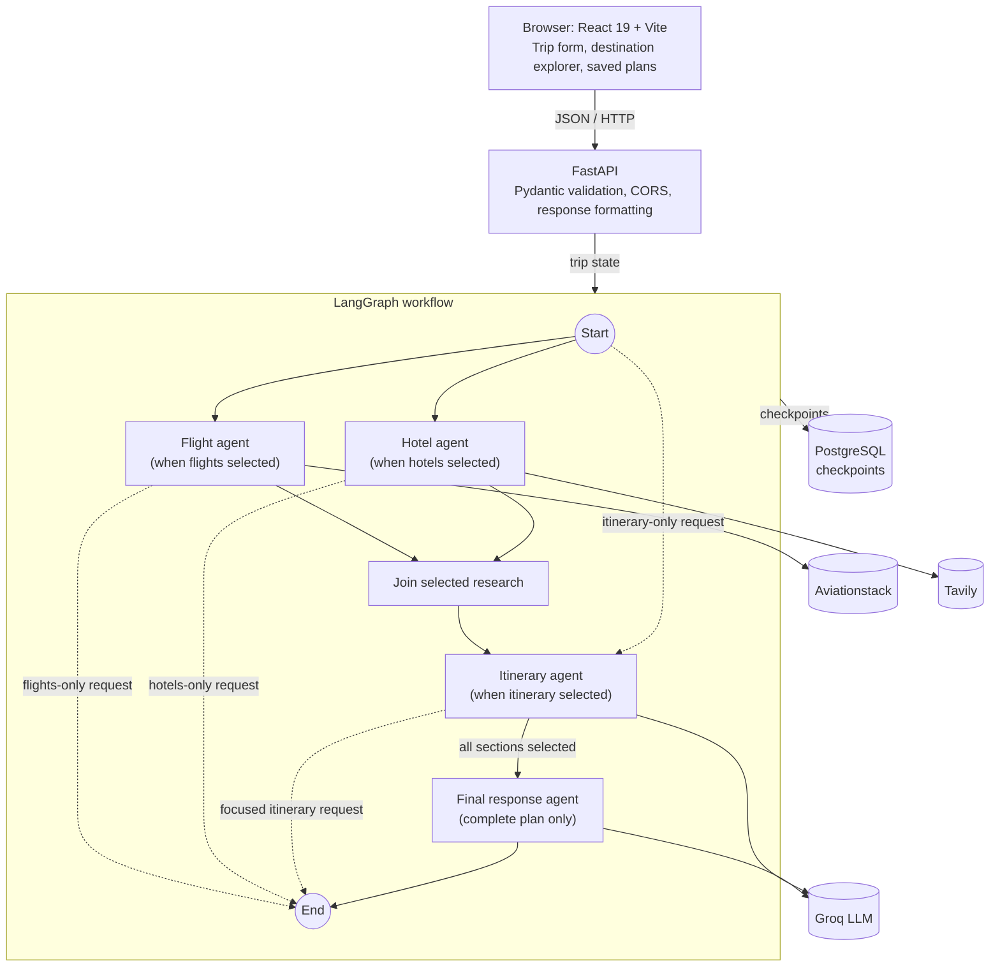

<h1 align="center">Elsewhere</h1>

<p align="center">
  An AI-assisted travel planner that turns your destination, dates, budget and
  interests into flight research, hotel references and a day-by-day itinerary.
</p>

<p align="center">
  
  
  
  
  
</p>

<!-- Add a screenshot or demo GIF here:
<p align="center"></p> -->

---

## Overview

Elsewhere is a full-stack, multi-agent AI project I built to plan trips. You
enter a departure city, destination, travel dates, group size, budget and
preferences, then run a focused flight, hotel or itinerary search, or generate a
complete trip plan.

A FastAPI backend runs a LangGraph workflow with specialised agents:

- **Flight agent:** retrieves flight records from Aviationstack
- **Hotel agent:** gathers hotel references with Tavily web search
- **Itinerary agent:** writes a day-by-day plan with a Groq-hosted LLM
- **Final response agent:** combines everything into one summary (complete plans only)

Elsewhere is a planning assistant, not a booking service. It is clear about what
its sources can and cannot confirm (see [Limitations](#limitations)).

## Features

- 🧭 **Explore destinations** and start a plan from a suggestion or your own destination
- ✈️ **Flight research** from the Aviationstack feed
- 🏨 **Hotel references** from Tavily, with links to source pages
- 🗓️ **Day-by-day itinerary** with activity and meal suggestions
- ✨ **Complete trip plan** that combines all of the above with a summary
- 💵 **Budget context** shown alongside notes on unavailable fares and rates
- 📚 **My Trips** to reopen up to eight complete plans saved in your browser

## Architecture



The frontend sends a validated trip request to `POST /plan-trip`. The API
creates a unique LangGraph thread ID and runs either the requested sections or
the complete workflow. Flight and hotel research run in parallel when selected.
The itinerary agent waits for the selected research to finish, or runs directly
for an itinerary-only request. The final response agent runs only for complete
plans. The API formats the results into structured flight and hotel records for
the browser. PostgreSQL stores graph checkpoints through LangGraph's
`PostgresSaver`.

The backend owns all provider credentials, so API keys never reach the
frontend. Trip form state and saved plans live in the browser's local storage;
there are no user accounts.

## Tech stack

| Area | Technologies |
|---|---|
| Frontend | React 19, Vite 7, Lucide React, React Markdown |
| API | Python 3.10+, FastAPI, Uvicorn, Pydantic |
| Agent workflow | LangGraph, LangChain Core |
| Language model | Groq via `langchain-groq` (`openai/gpt-oss-20b`) |
| Travel research | Aviationstack, Tavily |
| Persistence | PostgreSQL, Psycopg 3, `langgraph-checkpoint-postgres` |
| Configuration | `python-dotenv` |

## API

**`POST /plan-trip`** accepts trip details as JSON:

```json
{
  "query": "Kyoto, Japan",
  "duration_days": 5,
  "budget": 2500,
  "traveller_count": 2,
  "departure_city": "San Francisco",
  "destination_city": "Kyoto",
  "destination_country": "Japan",
  "departure_date": "2026-11-01",
  "return_date": "2026-11-06",
  "preferences": "Food and gardens",
  "sections": ["flights", "hotels", "itinerary"]
}
```

`sections` accepts any unique, non-empty combination of `flights`, `hotels` and
`itinerary`. Omitting it runs all three plus the final response agent.

**`GET /health`** is a health check. Interactive docs are at
<http://localhost:8000/docs> when the backend is running.

## Limitations

## Design notes

- **Agent workflow:** a LangGraph graph with separate flight, hotel and
  itinerary agents sharing one trip state. Flight and hotel research run in
  parallel; the itinerary waits for selected research results, and a final
  response agent combines the results for complete plans.
- **Focused or complete searches:** the `sections` field lets the same endpoint
  run a single agent or the whole workflow.
- **Validated input:** requests are validated with Pydantic before the graph is
  invoked, and trip details are normalized.
- **Checkpoint persistence:** each request runs under a unique LangGraph thread
  ID, and graph checkpoints are stored in PostgreSQL through `PostgresSaver`.
- **Credential safety:** Groq, Aviationstack and Tavily keys live only in the
  backend's `.env` file.
- **Source honesty:** the interface discloses what each source can and cannot
  confirm instead of presenting estimates as facts.
- **Local-first saved plans:** complete plans are stored in the browser, so
  there are no user accounts to manage.

## Limitations

- **Flights:** Aviationstack records are returned without filtering by the
  requested route or dates. This integration does not provide fares.
- **Hotels:** Tavily returns hotel-related web-search references, not verified
  availability, room rates, amenities or property images.
- **Itinerary:** Activities and expenses are LLM-generated suggestions and
  estimates, not confirmed prices or bookings.
- **Persistence:** PostgreSQL stores LangGraph checkpoints. Trip forms and saved
  complete plans are stored locally in the browser, not in user accounts.
- **Credentials:** Groq, Aviationstack and Tavily keys stay in the backend's
  local `.env` file; never place real credentials in frontend configuration or
  commit them to Git.

## Future improvements

Ideas for extending the project (not currently implemented):

- Route- and date-aware flight search with fares
- Hotel sources that return live availability and rates
- Retries and fallbacks for provider failures
- User accounts and server-side trip history
- Automated tests and an evaluation set for itinerary quality

## Getting started

### Prerequisites

- Python 3.10+
- A reachable PostgreSQL database
- Node.js 20.19+ (or 22.12+) and npm
- API keys for [Groq](https://console.groq.com/), [Aviationstack](https://aviationstack.com/) and [Tavily](https://tavily.com/)

### Backend

From the project root:

```bash
python -m venv .venv
# Windows (PowerShell): .\.venv\Scripts\Activate.ps1
# macOS / Linux:        source .venv/bin/activate
python -m pip install -r requirements.txt
```

Create a root `.env` file (never commit it):

```dotenv
GROQ_API_KEY=your_groq_key
AVIATIONSTACK_API_KEY=your_aviationstack_key
TAVILY_API_KEY=your_tavily_key
DATABASE_URL=your_postgresql_connection_string
FRONTEND_ORIGINS=http://localhost:5173,http://127.0.0.1:5173
```

Start the API:

```bash
uvicorn api:app --reload
```

It runs at <http://localhost:8000> and initializes the PostgreSQL checkpointer
on startup.

### Frontend

In a separate terminal:

```bash
cd frontend
npm install
```

Create `frontend/.env`:

```dotenv
VITE_API_URL=http://localhost:8000
```

Start the dev server:

```bash
npm run dev
```

Open the URL Vite prints (usually <http://localhost:5173>). To build for
production, run `npm run build`; the output goes to `frontend/dist`.

## Troubleshooting

- **Frontend cannot reach the API:** confirm the API is running and `VITE_API_URL` is correct. If the frontend origin changed, add it to `FRONTEND_ORIGINS` and restart the API.
- **API does not start:** check that PostgreSQL is reachable and `DATABASE_URL` is set in the root `.env`.
- **A provider request fails:** check the matching Groq, Aviationstack or Tavily key and the API terminal logs.
- **No fares or live hotel rates:** the current provider integrations do not return them.
