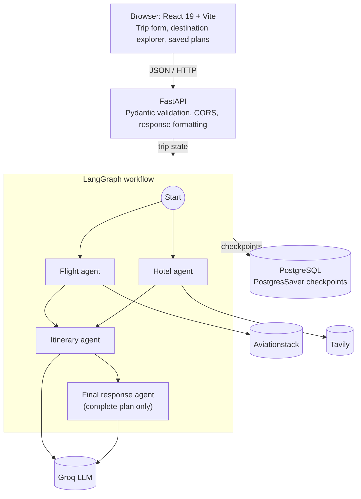

<h1 align="center">Elsewhere</h1>

<p align="center">
  An AI-assisted travel planner that turns your destination, dates, budget and
  interests into flight research, hotel references and a thoughtful day-by-day
  itinerary.
</p>

<p align="center">
  
  
  
  
  
  
</p>

<!--
  Add screenshots or a short demo GIF here, for example:
  <p align="center"></p>
-->

---

## Table of contents

- [About](#about)
- [Features](#features)
- [How it works](#how-it-works)
- [Architecture](#architecture)
- [Technology](#technology)
- [Using Elsewhere](#using-elsewhere)
- [API](#api)
- [Design notes](#design-notes)
- [Data and limitations](#data-and-limitations)
- [Future improvements](#future-improvements)
- [Getting started](#getting-started)
- [Troubleshooting](#troubleshooting)

## About

Planning a trip means balancing many details at once: where to go, how to get
there, where to stay, what to do each day, and how to stay within budget.
Elsewhere brings that research into one travel-planning workspace. Enter your
departure city, destination, travel dates, group size, budget and preferences,
then choose a focused flight, hotel or itinerary search, or ask the planner to
bring all three together.

Behind the interface, a FastAPI service runs a LangGraph workflow. The flight
agent retrieves records from Aviationstack while the hotel agent gathers
web-search references with Tavily; these independent searches run in parallel.
The itinerary agent uses a Groq-hosted language model to create a daily plan
after the requested research completes. For a complete plan, a final model step
combines the results.

Elsewhere is designed to be clear about what its sources can and cannot confirm:
flight records are not route-filtered or priced, hotel references are not live
availability, and itinerary expenses are estimates rather than quotes. It is a
planning assistant, not a booking service.

## Features

| | |
|---|---|
| 🧭 **Explore destinations** | Browse destination inspiration and start a trip plan for a selected place or your own destination. |
| ✈️ **Flight research** | View flight-feed records returned by Aviationstack, with source limitations disclosed. |
| 🏨 **Accommodation research** | Review Tavily hotel-related search references and open their source pages. |
| 🗓️ **Day-by-day itinerary** | Generate daily activity and meal suggestions tailored to your trip details and preferences. |
| ✨ **Complete trip plan** | Bring flight research, hotel references, an itinerary and an integrated summary together. |
| 💵 **Budget context** | See your budget target alongside clear notes about unavailable fares and accommodation rates. |
| 📚 **My Trips** | Reopen up to eight complete plans saved in your current browser. |

## How it works

1. **Submit.** The React frontend sends a validated trip request to `POST /plan-trip`.
2. **Normalize.** FastAPI validates the request with Pydantic, normalizes the trip
   details and creates a unique LangGraph thread ID.
3. **Plan.** LangGraph runs independent flight and hotel research in parallel.
   When requested, the itinerary agent waits for those results, then the final
   response agent combines the complete plan:

   | Agent | Source | Output |
   |---|---|---|
   | Flight agent | Aviationstack | Flight-feed records |
   | Hotel agent | Tavily | Hotel-related web-search references |
   | Itinerary agent | Groq LLM (`openai/gpt-oss-20b`) | Day-by-day activities, meals and estimated expenses |
   | Final response agent | Groq LLM | Integrated summary (complete plans only) |

4. **Checkpoint.** LangGraph's `PostgresSaver` stores graph checkpoints in PostgreSQL.
5. **Format and return.** The API formats provider results into structured flight
   and hotel records and returns them to the browser.
6. **Save.** Complete plans are stored in the browser's local storage and appear
   under **My Trips**.

## Architecture



The backend owns the provider credentials, so API keys are never placed in the
frontend. The browser stores trip form state and saved complete plans in local
storage; there is no user-account or server-side trip-history feature.

## Technology

| Area | Technologies |
|---|---|
| Frontend | React 19, Vite 7, Lucide React, React Markdown |
| API | Python 3.10+, FastAPI, Uvicorn, Pydantic |
| Agent workflow | LangGraph, LangChain Core |
| Language model | Groq through `langchain-groq`, using `openai/gpt-oss-20b` |
| Travel research | Aviationstack flight feed, Tavily web search |
| Checkpoint persistence | PostgreSQL, Psycopg 3, `langgraph-checkpoint-postgres` |
| Configuration | `python-dotenv`, local environment files |

## Using Elsewhere

1. Open **Explore** and choose a destination, or enter your own.
2. Fill in your departure city, destination city and country, travel dates,
   number of travellers, budget in USD, and any preferences.
3. Choose **Flights**, **Hotels & stays**, or **Itinerary** for a focused result;
   choose **Complete trip plan** to run the full workflow.
4. Review the returned research and itinerary. Complete plans are saved under
   **My Trips** in the current browser and can be reopened on that device.

## API

### `POST /plan-trip`

Accepts trip details as JSON and returns the requested sections.

```json
{
  "query": "Kyoto, Japan",
  "duration_days": 5,
  "budget": 2500,
  "traveller_count": 2,
  "departure_city": "San Francisco",
  "destination_city": "Kyoto",
  "destination_country": "Japan",
  "departure_date": "2026-11-01",
  "return_date": "2026-11-06",
  "preferences": "Food and gardens",
  "sections": ["flights", "hotels", "itinerary"]
}
```

`sections` accepts any unique, non-empty combination of `flights`, `hotels` and
`itinerary`. Omitting it selects all three and runs the final response agent.

### `GET /health`

Health check endpoint.

When the backend is running, interactive documentation is available at
<http://localhost:8000/docs>.

## Design notes

- **Agent workflow:** a LangGraph graph with separate flight, hotel and
  itinerary agents sharing one trip state. Flight and hotel research run in
  parallel; the itinerary waits for selected research results, and a final
  response agent combines the results for complete plans.
- **Focused or complete searches:** the `sections` field lets the same endpoint
  run a single agent or the whole workflow.
- **Validated input:** requests are validated with Pydantic before the graph is
  invoked, and trip details are normalized.
- **Checkpoint persistence:** each request runs under a unique LangGraph thread
  ID, and graph checkpoints are stored in PostgreSQL through `PostgresSaver`.
- **Credential safety:** Groq, Aviationstack and Tavily keys live only in the
  backend's `.env` file.
- **Source honesty:** the interface discloses what each source can and cannot
  confirm instead of presenting estimates as facts.
- **Local-first saved plans:** complete plans are stored in the browser, so
  there are no user accounts to manage.

## Data and limitations

- **Flights:** Aviationstack records are returned without filtering by the
  requested route or dates. This integration does not provide fares.
- **Hotels:** Tavily returns hotel-related web-search references, not verified
  availability, room rates, amenities or property images.
- **Itinerary:** Activities and expenses are LLM-generated suggestions and
  estimates, not confirmed prices or bookings.
- **Persistence:** PostgreSQL stores LangGraph checkpoints. Trip forms and saved
  complete plans are stored locally in the browser, not in user accounts.
- **Credentials:** Groq, Aviationstack and Tavily keys stay in the backend's
  local `.env` file; never place real credentials in frontend configuration or
  commit them to Git.

## Future improvements

Ideas for extending the project (not currently implemented):

- Route- and date-aware flight search with fares
- Hotel sources that return live availability and rates
- Running the independent flight and hotel agents in parallel
- Retries and fallbacks for provider failures
- User accounts and server-side trip history
- Automated tests and an evaluation set for itinerary quality

## Getting started

### Prerequisites

- Python 3.10 or newer
- A reachable PostgreSQL database
- Node.js 20.19+ (or 22.12+) and npm
- API keys for [Groq](https://console.groq.com/),
  [Aviationstack](https://aviationstack.com/) and [Tavily](https://tavily.com/)

### Backend

From the project root, create a virtual environment and install the Python
dependencies.

**Windows (PowerShell)**

```powershell
python -m venv .venv
.\.venv\Scripts\Activate.ps1
python -m pip install -r requirements.txt
```

**macOS / Linux**

```bash
python3 -m venv .venv
source .venv/bin/activate
python -m pip install -r requirements.txt
```

Create a root `.env` file with your local credentials and database URL. Keep
real credentials private; `.env` files are excluded by the root `.gitignore`.

```dotenv
GROQ_API_KEY=your_groq_key
AVIATIONSTACK_API_KEY=your_aviationstack_key
TAVILY_API_KEY=your_tavily_key
DATABASE_URL=your_postgresql_connection_string
FRONTEND_ORIGINS=http://localhost:5173,http://127.0.0.1:5173
```

Start the API from the project root:

```bash
uvicorn api:app --reload
```

The API runs at <http://localhost:8000>. On startup it initializes the
PostgreSQL checkpointer. If your frontend uses a different origin, update
`FRONTEND_ORIGINS` and restart the API.

### Frontend

Open a separate terminal and install the frontend dependencies.

**Windows (PowerShell)**

```powershell
Set-Location .\frontend
npm install
```

**macOS / Linux**

```bash
cd frontend
npm install
```

Create `frontend/.env` with the local API URL:

```dotenv
VITE_API_URL=http://localhost:8000
```

Start the Vite development server:

```bash
npm run dev
```

Open the local URL printed by Vite (usually <http://localhost:5173>). To build
the production frontend, run `npm run build` from the `frontend` directory;
Vite writes the output to `frontend/dist`.

## Troubleshooting

- **The frontend cannot reach the planner:** confirm the API is running and
  `VITE_API_URL` points to it. If you changed the frontend's origin, add it to
  `FRONTEND_ORIGINS` and restart the API.
- **The API does not start:** verify that PostgreSQL is reachable and
  `DATABASE_URL` is set correctly in the root `.env`.
- **A provider request fails:** check the corresponding Groq, Aviationstack or
  Tavily key in the backend `.env` and review the API terminal logs.
- **No fares or live hotel rates appear:** these details are not returned by
  the current provider integrations.
